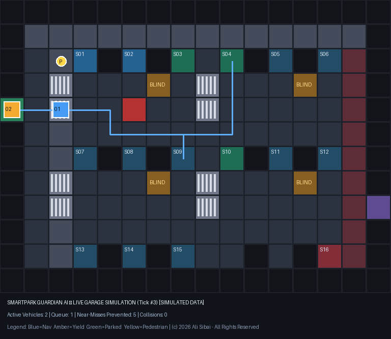
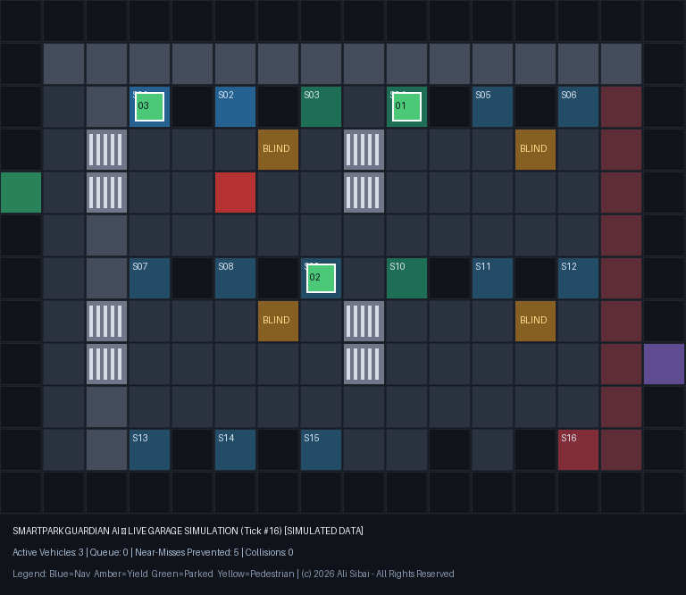
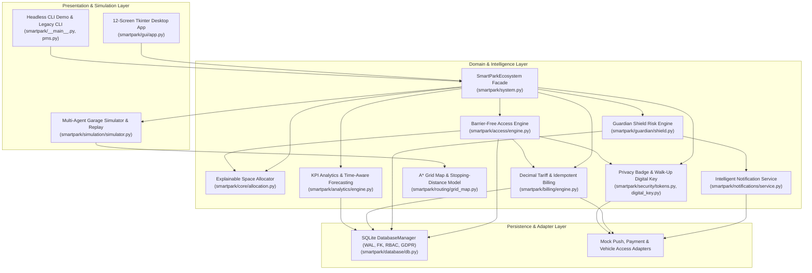

# SmartPark Guardian AI

**Barrier-Free, Intelligent, Secure, and Accident-Aware Parking Ecosystem**

SmartPark Guardian AI transforms a single-file Python parking script ([`pms.py`](pms.py)) into a modular, persistent, privacy-preserving, and safety-aware parking management platform. It demonstrates how digital access authorization, explainable multi-criteria space allocation, vehicle-session security monitoring (**Guardian Shield**), temporary cryptographic parking badges, and A* accident-prevention simulation work together seamlessly.

---

## 1. Visual Simulation & Demonstration

### Active A* Routing & Proactive Crosswalk Yielding (Tick #3)


### Completed Multi-Vehicle Navigation & Dynamic Obstacle Rerouting (Tick #16)


---

## 2. System Architecture

The core parking, access, security, routing, billing, and analytics engines are strictly decoupled from the Tkinter desktop GUI and image renderer:



### Package Layout

```text
smartpark/
├── config/          # Typed configuration, Decimal tariffs, allocation weights, GDPR retention policies
├── core/            # Domain dataclasses/enums, explainable space allocator, thread-safe ParkingEngine
├── database/        # SQLite connection manager, migrations, BEGIN IMMEDIATE transactions, RBAC & GDPR purge
├── access/          # Barrier-free arrival & departure workflows, fail-secure entry & anti-entrapment egress
├── guardian/        # Guardian Shield deterministic sensor correlation & ethical anti-surveillance rules
├── notifications/   # Severity-based notification service, cooldowns, quiet hours & MockPushNotificationProvider
├── security/        # HMAC-SHA256 Privacy-First QR Badges (rolling slots) & 7-step Walk-Up Digital Key
├── routing/         # 16x12 GarageGridMap, safety-weighted A* pathfinding & kinematic stopping-distance model
├── simulation/      # Multi-agent vehicle/pedestrian simulator, near-miss prevention, replay & PNG exporter
├── billing/         # Timezone/DST-accurate Decimal billing, grace periods, daily caps, idempotency & refunds
├── analytics/       # Synthetic dataset generator, time-aware Ridge Harmonic forecasting vs. naive baseline
├── gui/             # 12-screen high-contrast Tkinter desktop application with dark/light mode
└── system.py        # Unified SmartParkEcosystem orchestrator
pms.py               # Legacy-compatible CLI & classes with all Milestone 1 bugs resolved
tests/               # 25 automated unit, concurrency, security, DST, fail-safe & integration tests
docs/assets/         # Generated simulation snapshots
scripts/             # Utility script to regenerate visual simulation assets
```

---

## 3. Milestone 1 Inspection: Bugs Identified and Fixed in Original `pms.py`

During Milestone 1 inspection of the original [`pms.py`](pms.py), six critical defects were identified and resolved while preserving full backward compatibility:

1. **`DynamicPricing.calculate_fee` Crash (`AttributeError`) & Float Precision**:
   - *Bug*: `calculate_fee(self, duration)` received a `datetime.timedelta` object (`exit_time - entry_time`) and attempted to access `duration.start.hour` and `duration.end.hour`, crashing with `AttributeError: 'datetime.timedelta' object has no attribute 'start'`. It also used binary `float` arithmetic.
   - *Fix*: Updated `calculate_fee` to use `decimal.Decimal` (`ROUND_HALF_UP`) and accept optional `entry_time` / `exit_time` timestamps while safely handling plain `timedelta` inputs without crashing.
2. **CLI Options 8 & 9 Crash (`TypeError` and `KeyError`)**:
   - *Bug*: `main()` called `analytics_engine.generate_occupancy_report1()` and `generate_revenue_report1()` without their two required arguments (`start_time, end_time`), raising `TypeError`. Additionally, `generate_occupancy_report1` omitted `'license_plate'` from its returned dictionaries while `main()` line 283 indexed `data['license_plate']` (`KeyError`).
   - *Fix*: Made `start_time` and `end_time` optional filter parameters and included `'license_plate'` in all occupancy report records.
3. **Permanent Zero Revenue After Space Vacation**:
   - *Bug*: `ParkingSpace.vacate()` cleared `self.vehicle = None`, and `AnalyticsEngine.generate_revenue_report()` only inspected currently occupied `space.vehicle` objects that also had a non-null `exit_time`—an impossible state—causing revenue reports to always return `0`.
   - *Fix*: Added `completed_sessions` and automatic payment settlement on `ParkingLot.vacate_space()` so `AnalyticsEngine` accurately reports revenue across completed sessions.
4. **Negative Occupancy Count on Repeated `vacate_space` Calls**:
   - *Bug*: `ParkingLot.vacate_space(space_id)` unconditionally executed `self.occupied_spaces -= 1` even when the space was already vacant.
   - *Fix*: Synchronized `occupied_spaces` against actual space occupancy state and ignored vacating already-vacant bays.
5. **Ignored Reservations & Overlapping Booking Intervals**:
   - *Bug*: `ParkingSpace.reserve()` overwrote existing reservations without checking interval overlap (`start_time < existing.end_time and end_time > existing.start_time`), and `park_vehicle()` allocated spaces reserved for other customers.
   - *Fix*: Added interval-overlap validation and reservation-aware space selection.
6. **Hardcoded `input()` Inside Domain Methods**:
   - *Fix*: Domain methods in `pms.py` now accept direct arguments for programmatic and automated test execution while falling back to `input()` when called interactively.

---

## 4. Installation & How to Run

### Prerequisites
- **Python 3.11 or newer** (tested on Python 3.12).
- Standard library modules (`sqlite3`, `tkinter`, `decimal`, `unittest`, `zoneinfo`) plus `tzdata` and `pillow`.

### Setup

```bash
python -m venv .venv
# Windows PowerShell:
.\.venv\Scripts\Activate.ps1
# Linux / macOS:
# source .venv/bin/activate

pip install -r requirements.txt
```

### Run the 60-FPS Automotive Digital Twin & Live Python Web Command Center

```bash
python -m smartpark --web --port 8080
```
Then open **`http://localhost:8080/`** in your browser (or visit the live cloud deployment at **[https://alisibai.vercel.app/smartpark.html](https://alisibai.vercel.app/smartpark.html)**).

### Run the 12-Screen Desktop Application (GUI)

```bash
python -m smartpark
# or via the legacy entrypoint flag:
python pms.py --gui
```

### Run the Headless Deterministic Demonstration & Export Simulation PNG

```bash
python -m smartpark --demo --export-png docs/assets/simulation_snapshot.png
```

### Run the Legacy Interactive CLI (`pms.py`)

```bash
python pms.py
```

### Run the Full Automated Test Suite

```bash
python -m unittest discover -s tests -v
```

---

## 5. Honest Engineering Summary: What Works, What Is Simulated, and What Needs Real Infrastructure

| Subsystem | Implemented & Verified in Software | Clearly Labeled Simulation | Required for Real Physical Deployment |
| :--- | :--- | :--- | :--- |
| **Core & Persistence** | SQLite WAL database, schema migrations, `BEGIN IMMEDIATE` concurrency locks, RBAC permissions, audit logs, GDPR retention purge & right-to-erasure. | Default `:memory:` or local `.db` file with synthetic demo data. | Managed PostgreSQL/SQLite server with encrypted storage (LUKS/BitLocker) and TLS. |
| **Barrier-Free Access** | Ownership correlation (plate alone never grants entry), reservation window checks, duplicate suppression, fail-secure entry hold (`FAILSAFE_HOLD`), anti-entrapment exit override (`EMERGENCY_OVERRIDE`). | Simulated LPR camera confidence, BLE beacon handshake, and RFID tag reads. | Certified physical ANPR/LPR cameras, UWB/BLE roadside units, and EN-12453 compliant gate/lane controllers installed by qualified engineers. |
| **Guardian Shield** | Deterministic multi-sensor correlation, duplicate suppression, unauthenticated event rejection, and ethical rule (`R_ETHICS_NO_PROXIMITY_ACCUSATION`: pedestrian proximity never triggers an accusation or alarm). | Simulated door, vibration, impact, glass-tamper, and bay proximity telemetry. | Authenticated OEM vehicle telematics webhooks (e.g., ISO 20078 / Extended Vehicle API) and signed bay sensor gateways. |
| **Push Notifications** | Severity routing (`INFORMATIONAL`, `ATTENTION_REQUIRED`, `HIGH_PRIORITY`), quiet hours, cooldowns, hourly rate limits, trusted-contact escalation. | `MockPushNotificationProvider` delivering to in-app inbox and simulating offline phones / gateway outages. | Apple Push Notification service (APNs), Firebase Cloud Messaging (FCM), or WebPush credentials. |
| **Walk-Up Digital Key** | 7-step workflow: BLE proximity check, account/enrollment verification, short-lived `WalkUpChallenge`, single-use nonce replay protection, rate limiting, HMAC biometric confirmation check. | `SimulatedVehicleAccessAdapter` tracking virtual lock state without touching real vehicles. | CCC Digital Key / Car Connectivity Consortium compliant OEM secure-element applet and UWB/BLE ranging hardware. |
| **Privacy Parking Badge** | HMAC-SHA256 signed expiring tokens, 30-second rolling slot anti-screenshot protection, server-side revocation, zero PII / no raw plate on badge. | ASCII QR matrix preview and simulated scanner verification. | Optical QR/NFC readers at pedestrian doors and exit verification kiosks. |
| **Accident Prevention & Routing** | 16x12 `GarageGridMap`, safety-weighted A* pathfinding, dynamic blocked-route rerouting, kinematic stopping-distance calculation, trajectory conflict prediction, deterministic replay. | Discrete-tick multi-agent vehicle/pedestrian simulation (`GarageSimulator`). | LiDAR/radar bay occupancy sensors and dynamic LED lane signage (never direct vehicle braking/steering control). |
| **Billing & Analytics** | `Decimal` tariff calculation across `Europe/Berlin` DST transitions, grace periods, daily caps, idempotency keys, refunds, and time-aware Ridge Harmonic demand forecasting (+12.14% MAE improvement over seasonal-naive baseline). | `SimulatedPaymentProvider` and synthetic 14-day hourly history. | PCI-DSS compliant payment processor (e.g., Stripe / Adyen server-side webhooks) and live historical telemetry warehouse. |

---

## 6. Privacy, GDPR, and Regulatory Compliance Notes (Germany / EU)

- **Data Minimization & Pseudonymization**: Customer identity (`Customer`) is separated from public parking operations via `public_alias` (`MBR-...`), `public_vehicle_token` (`PVT-...`), and `public_badge_id` (`BDG-...`). Raw license plates are hashed (`SHA-256`) for lookup and masked (`B-***26`) in routine displays.
- **No Continuous Location Tracking or Biometric Surveillance**: The system does not track customer GPS outside the garage or perform facial/appearance recognition on pedestrians.
- **Automated Retention & Right to Erasure**: `DatabaseManager.purge_expired_records` purges access logs (default 30 days) and sensor telemetry (default 14 days) while preserving statutory tax ledger totals, and `anonymize_and_delete_customer` scrubs customer PII upon request.
- **Legal Notice**: Before any real-world deployment in Germany or the European Union, operators must conduct a formal Data Protection Impact Assessment (DPIA / *DSFA* under Art. 35 GDPR), comply with BDSG § 4 video/optical sensor signage rules, and validate physical emergency egress compliance (*Garagenverordnung — GaVO*) with qualified legal and structural professionals.

---

## 7. Feature Roadmap

- [x] **Milestone 1**: Inspect legacy `pms.py`, fix runtime crashes, and preserve backward-compatible CLI.
- [x] **Milestone 2**: Persistent SQLite database (`WAL`, foreign keys, migrations) and explainable space allocator.
- [x] **Milestone 3**: Barrier-free arrival/departure engine with fail-secure entry and anti-entrapment exit.
- [x] **Milestone 4**: Multi-agent animated garage and vehicle simulation with deterministic replay.
- [x] **Milestone 5**: SmartPark Guardian Shield risk correlation engine and rate-limited push notifications.
- [x] **Milestone 6**: Temporary HMAC-signed privacy badges (anti-screenshot rolling slots) and 7-step Walk-Up Digital Key.
- [x] **Milestone 7**: A* pathfinding, dynamic blocked-route rerouting, stopping-distance model, and near-miss prevention.
- [x] **Milestone 8**: Timezone/DST-safe `Decimal` billing, idempotent payments, refunds, and time-aware demand forecasting.
- [x] **Milestone 9**: 25-test automated suite, 12-screen Tkinter desktop app, CI workflow, and documentation.
- [ ] **Future Milestone 10**: Optional FastAPI REST/WebSocket mobile companion backend and OCPP 2.0.1 EV charger load management integration.

---

## 8. Copyright, Legal Ownership & Intellectual Property Protection

**Copyright © 2026 Ali Sibai. All Rights Reserved / Alle Rechte vorbehalten.**

This project (**SmartPark Guardian AI** / **PMS**), including all Python & JavaScript source code, software architecture, algorithms, database schemas, simulation models, user interfaces, and documentation, is the original creation and exclusive intellectual property of **Ali Sibai** ([https://alisibai.vercel.app/](https://alisibai.vercel.app/) | [https://github.com/sibaiali](https://github.com/sibaiali)).

- **Legal Protection**: Protected under the **German Copyright Act (*Urheberrechtsgesetz — UrhG*, §§ 2, 7, 12–14, 69a–69g UrhG)**, EU Directive 2009/24/EC, and the Berne Convention. Under §§ 12–14 and § 29 UrhG, the authorship (*Urheberschaft*) of Ali Sibai is legally inalienable (*unübertragbar*).
- **Source-Available for Evaluation Only**: Published exclusively for technical inspection and evaluation by prospective employers, recruiters, and academic reviewers.
- **Strict Prohibition of Misappropriation**: Unauthorized copying, redistribution, removal of copyright notices (§ 95c UrhG), plagiarism, framing, or commercial use is strictly prohibited. See [`LICENSE`](LICENSE) and [`COPYRIGHT.md`](COPYRIGHT.md) for full legal terms.
